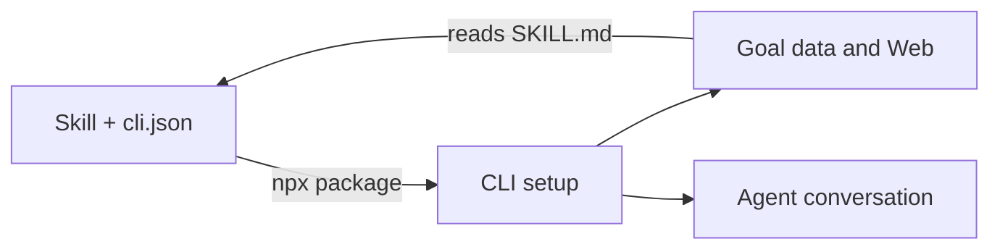

# A skill and a CLI

| Responsibility | Owner |
| --- | --- |
| Outcome, feedback and decision guidance for the agent | chill-agent skill |
| Which CLI to run (`cli.json`) | chill-agent skill |
| Setup, Goal data, Deliverables, Conversation and Letters | CLI |
| Web, native delivery and execution coordination | CLI |
| Autonomy's end-of-turn checks and approvals, notifications, public link, first-use session and host guides | CLI (built-in extensions for the optional parts) |
| Following a changed `cli.json` on Web start or the update button | CLI |

The two repositories share only two contracts, both defined by the CLI: the
`package` value is passed to npx unchanged, and `setup prepare --version-file`
records where `cli.json` lives. The CLI does not know how it was installed or
how the skill is arranged; it uses the guide location that setup recorded.

Standalone CLI users get the same built-in extensions and can disable them. The
CLI owns [extension mechanics](https://github.com/game-dev-rta-club/chill-agent-cli/blob/main/docs/extensions.md)
and [server lifetime](https://github.com/game-dev-rta-club/chill-agent-cli/blob/main/docs/runtime/server.md).
See [Change the skill and choose its CLI](development/skill-and-cli.md) for development.
